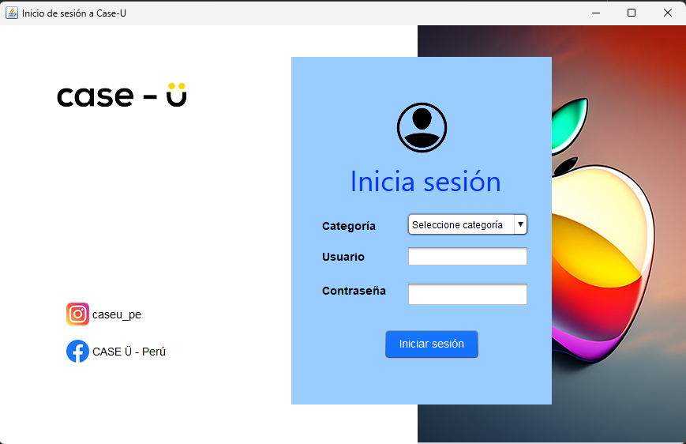

# Sistema de Ventas "Case-U"

## 📝 Descripción Profesional
Aplicación nativa de escritorio desarrollada con Java Swing para la administración operativa de un negocio retail (Case-U). El sistema gestiona las operaciones de caja a través de una arquitectura transaccional utilizando JDBC para comunicarse con una base de datos MySQL relacional. Incorpora autenticación de usuarios basada en roles, operaciones CRUD para el inventario de productos y una base de clientes, y un módulo robusto de procesamiento de ventas que genera facturación dinámica y reportes exportables en formato PDF mediante la librería iText.

## 🛠️ Stack de Tecnologías
* **Lenguaje:** Java 8+ / Programación Orientada a Objetos (POO).
* **Frontend / UI:** Java Swing.
* **Base de Datos / Backend:** MySQL Relacional (XAMPP), JDBC API.
* **Librerías Adicionales:** iTextPDF (Generación de reportería y facturas fiscales).
* **Patrón de Diseño:** Layered Architecture / DAO Pattern.

## 🚀 Instalación y uso
1. Clona el repositorio
2. Importa el proyecto en NetBeans o tu IDE preferido.
3. Configura la base de datos `sistemaventa` en tu motor de MySQL local y ejecuta el archivo [sistemaventa.sql](sistemaventa.sql) para importar las tablas y datos.
4. Ajusta la clase de conexión en `src/conexion/Conexion.java` si el usuario de tu servidor MySQL no es `root` o si usas contraseña.
5. Ejecuta la clase `Login` desde `src/vista/Login.java`.

### Credenciales de prueba
* **Usuario:** Admin
* **Contraseña:** 1234

## 💡 Aprendizaje obtenido (Reflexión)
*Este proyecto fue un hito fundamental en mi formación como desarrollador, ya que me permitió aterrizar conceptos teóricos de POO en software del mundo real. A través de este proceso, comprendí los desafíos de acoplar la interfaz gráfica con la base de datos en una capa separada, la importancia en el manejo unificado de excepciones usando librerías JDBC, y la integración de librerías de terceros (iText) en un entorno de negocio.*

## 🔖 Tags / Palabras clave
`Java`, `Desktop Application`, `MySQL`, `JDBC`, `CRUD`, `Software Architecture`, `Swing`, `PDF Generation`
